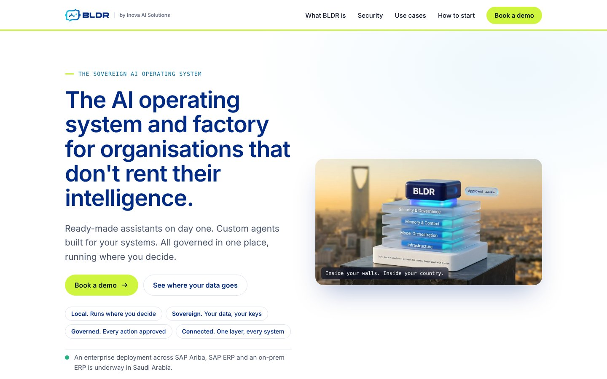
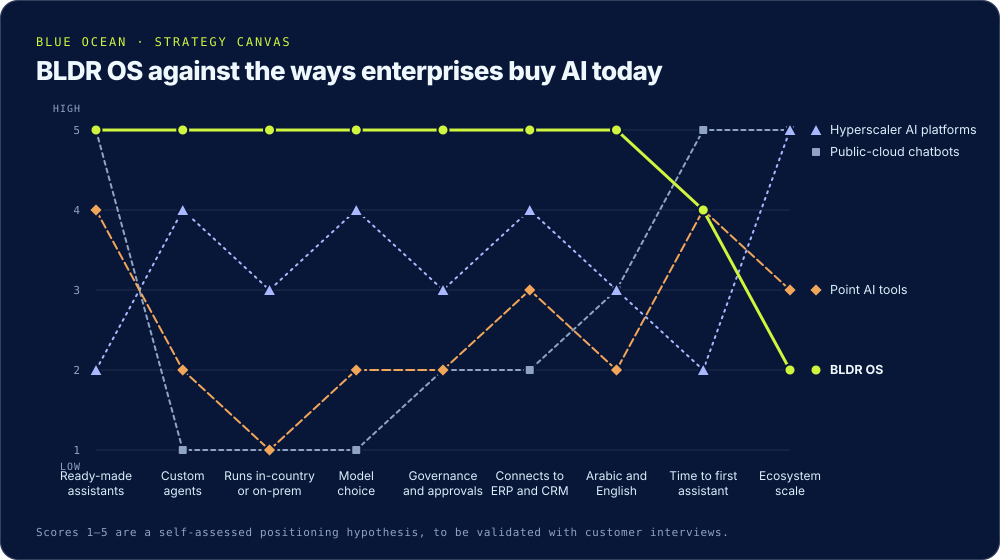
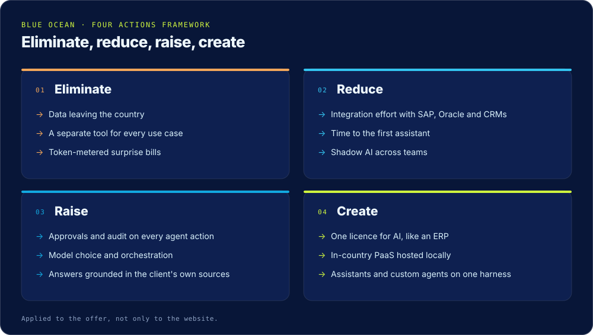
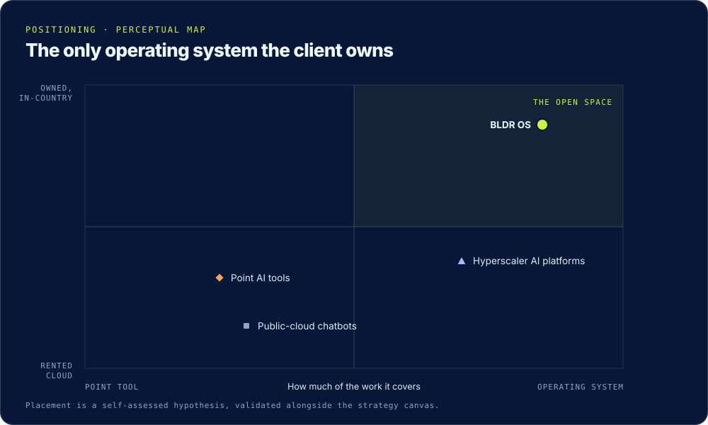

# bldr.bot

**The product site for BLDR OS, the in-country enterprise AI operating system: one page, one story, one action.**

> **BLDR OS** is the AI operating system and factory for organisations that don't rent their intelligence: ready-made chat and voice assistants on day one, custom agents built into the client's systems, all governed in one place and running where the client decides. Built by Inova AI Solutions. The site was designed and coded by **Youssef Jalloul**. Facts: [BRAND.md](BRAND.md).

`Live` · [bldr.bot](https://www.bldr.bot) · Rebuilt November 2026 · Last updated 21 Nov 2026



| | |
| --- | --- |
| **Role** | Product marketing, UX/UI design, copy, front-end development (Youssef Jalloul) |
| **Scope** | Information architecture, positioning, a one-page site, trust band, machine layer |
| **Stack** | Static HTML, CSS and vanilla JS · no build step · JSON-LD · Vercel |
| **This repo** | The marketing site only. The BLDR OS platform and console code are private. Booking link and analytics IDs are placeholders. |

---

## 1. The problem

> **Problem statement:** The old bldr.bot spread a no-code story across 19 sections and several pages. Enterprise buying committees couldn't see what BLDR is, where their data goes, or how to start.

**The fix:** one page for one buyer (the enterprise and government committee), one story, one action: **Book a demo**.

## 2. Success metrics

| Level | Metric |
| --- | --- |
| North star | Demos booked per month |
| Input | Scroll depth to the security section |
| Input | Clicks on "See where your data goes" |
| Guardrail | Mobile Lighthouse accessibility ≥ 95 |

## 3. The page, top to bottom

Each section carries its awareness level, its MEDDPICC job and the committee role it speaks to.

| # | Section | Awareness | MEDDPICC | For |
| --- | --- | --- | --- | --- |
| 1 | Hero: "The AI operating system and factory for organisations that don't rent their intelligence." | Unaware → solution | All | Champion |
| 2 | Systems band: "Built for the systems you already run." | Solution | Decision criteria | CIO |
| 3 | Why: the dark band on renting AI | Problem | Identify pain | Economic buyer |
| 4 | What BLDR is: assistants, your knowledge, custom agents, one governed platform | Solution | Decision criteria | CIO, architect |
| 5 | Security: where your data goes, deployment options, trust band | Solution, product | Paper process | CISO |
| 6 | Use cases by function and industry | Product | Metrics | Everyone |
| 7 | Built for the whole committee | Product | Champion | Champion |
| 8 | How to start with BLDR | Most aware | Decision process | Procurement |
| 9 | Your questions answered (FAQ schema) | All | Decision criteria | Everyone, and AI search |
| 10 | Book a demo | Most aware | Decision process | Champion |

## 4. Market and differentiation



**Reading it:** BLDR OS gives up ecosystem scale to the hyperscalers and wins on what they can't offer together: **in-country or on-prem deployment + governance on every action + model choice + ready-made assistants and custom agents on one platform.**





## 5. Key UX decisions

| Decision | Heuristic | Trade-off accepted |
| --- | --- | --- |
| **One page** instead of 19 sections and sub-pages; company, legal and contact live on inovasolutions.ai | Aesthetic and minimalist design | Less room for long-form content |
| **"See where your data goes"** as the secondary CTA | Visibility of system status | A dedicated security section to maintain |
| **Console screenshots labelled "sample data"** | Error prevention (of trust) | Less dramatic than invented results |
| **No phone numbers**, one booking route | Recognition over recall | Fewer contact options |
| **Trust badges worded "alignment / Ready"** | Honesty | Softer claims until audits exist |

## 6. Brand identity

BLDR's own cyan system on navy, with the signal-lime CTA shared with Inova. The BLDR mark is used as supplied. The BLDR design system is private; this repo ships the page's compiled styles only.

## 7. Accessibility, performance and AI search

- WCAG 2.2 AA contrast, visible focus, `prefers-reduced-motion` and `?static`.
- Static HTML with no build step; long-cache assets on Vercel.
- `genome.json`, `llms.txt`, `sitemap.xml` and FAQ schema so AI assistants describe BLDR accurately.

## 8. Learnings

1. **A product site has one buyer and one action.** Everything else moves to the company site.
2. **Answer the CISO on the page.** "Where does my data go?" is the question that unlocks the meeting.

---

## Run it locally

```bash
python3 -m http.server 8000   # open http://localhost:8000 (add ?static to stop motion)
```

## What's not in this repo

- The BLDR OS platform, console and agent code (private)
- Booking link and analytics IDs (placeholders)
- Pricing and partner terms

## Licence

Code: MIT. The BLDR and Inova names, logos, copy and imagery: © Inova AI Solutions Pty Ltd, all rights reserved.

## About the author

**Youssef Jalloul** is an AI entrepreneur and venture builder based in Sydney and Dubai, and the Founder and CEO of Inova AI Solutions. Over 20+ years he has built and exited multiple companies and created or implemented 200+ AI agents and proofs of concept. [youssefjalloul.com](https://youssefjalloul.com) · [LinkedIn](https://www.linkedin.com/in/youssef-jalloul/)
